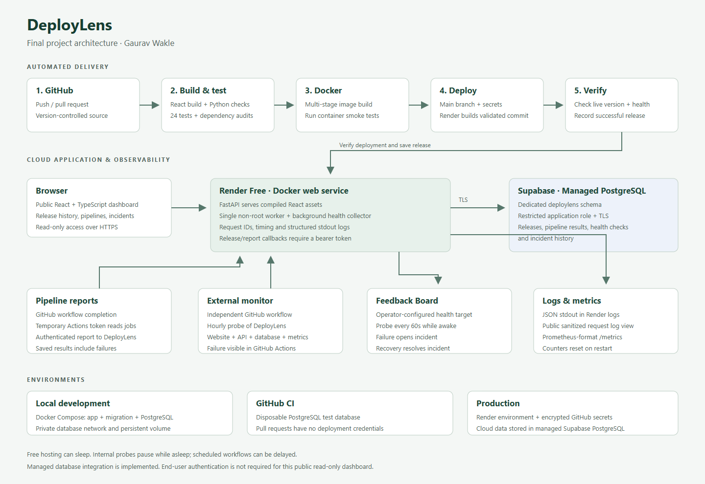

# DeployLens — Final Internship Submission

**Submitted by:** Gaurav Wakle  
**Project:** A release observability web application  
**Live website:** https://deploylens.onrender.com  
**GitHub repository:** https://github.com/Gauravwakle96/deploylens

DeployLens brings release history, GitHub Actions results, service health, incident
timelines and request logs into one dashboard. It monitors the existing Feedback Board
application and tracks its own deployments. The dashboard uses real pipeline results
and HTTP observations; saved history lives in managed PostgreSQL.

## Requirements and deliverables

| Requirement | Implementation | Submission evidence |
| --- | --- | --- |
| Build a real application | React + TypeScript dashboard and FastAPI REST backend | [Frontend](frontend/src/main.tsx), [backend](backend/main.py), [live website](https://deploylens.onrender.com) |
| Git and version control | Source, configuration and documentation in GitHub | [Repository](https://github.com/Gauravwakle96/deploylens) |
| Containerize | Multi-stage Docker build; non-root runtime; Compose application, migration and PostgreSQL services | [Dockerfile](Dockerfile), [Docker Compose](compose.yaml), [.dockerignore](.dockerignore) |
| Automated testing and build | Frontend build, Python lint/type checks, 24 tests including PostgreSQL integration, dependency audits, container smoke test | [CI/CD configuration](.github/workflows/ci.yml) |
| Deployment automation | CI deploys the validated commit through Render, checks the live version and records the release | [Successful full pipeline](https://github.com/Gauravwakle96/deploylens/actions/runs/42661628180) |
| Cloud infrastructure | Render Free Docker web service with HTTPS and provider health checks | [Deployment configuration](render.yaml), [live health](https://deploylens.onrender.com/health) |
| Managed DB/Auth | Supabase managed PostgreSQL, TLS, dedicated schema and restricted database role | [Verified database evidence](submission/final-verification.json) |
| Environment management | Local Compose, disposable CI database, production environment variables and encrypted GitHub environment secrets | [.env.example](.env.example), [operations guide](docs/OPERATIONS.md) |
| Active monitoring | Target probes every 60 seconds while awake; automatic failure/recovery incidents; independent hourly GitHub probe | [Monitor workflow](.github/workflows/monitor.yml), [monitor runs](https://github.com/Gauravwakle96/deploylens/actions/workflows/monitor.yml) |
| Logs and observability | Structured stdout logs, request IDs, latency, error counters and Prometheus-format metrics | [Metrics endpoint](https://deploylens.onrender.com/metrics), dashboard Logs view |
| Architecture diagram | Build/deploy flow, runtime, managed database and monitoring | [PNG diagram](docs/architecture.png), [SVG diagram](docs/architecture.svg), [architecture explanation](docs/ARCHITECTURE.md) |

The **managed database** provides the DB/Auth integration here. The dashboard is public
read-only, with bearer authentication for pipeline write callbacks. Supabase Auth and
end-user accounts are not implemented.

## Architecture



Render rebuilds the validated Git commit's Dockerfile. The CI image is tested before
deployment; this workflow does not promote an identical image digest between environments.
The production reporting workflow uses GitHub's temporary token to read actual workflow
results and sends them to an authenticated API endpoint.

## Run locally

```powershell
git clone https://github.com/Gauravwakle96/deploylens.git
cd deploylens
python scripts/setup_local.py
docker compose up -d --build --wait
```

Open http://localhost:8015. Docker Desktop must use Linux containers.
`docker compose down` stops the application while preserving the named database volume.

## Reviewer walkthrough

1. Open the live website and inspect the latest pipeline and release history.
2. Open **Pipelines**, select a run and follow its GitHub build-log link.
3. Inspect service health and the last probe timestamp. **Incidents** shows actual failures
   and recoveries when they have occurred; no incidents is a valid healthy state.
4. Open **Logs** and the metrics endpoint to inspect request counts, errors and timing.
5. Review the successful GitHub run: **Build & Test → Docker → Deploy → Monitor**.
6. Review the Docker/Compose files and architecture diagram above.

## Verification

- 24 tests passed in GitHub CI, including PostgreSQL integration.
- Production frontend build, TypeScript, Ruff and mypy passed.
- Python and Node dependency audits passed at verification time; source secret scan passed.
- Docker HTTP smoke checks passed; local Compose app and PostgreSQL were healthy.
- Stored observations survived container replacement. A database pause produced HTTP 503;
  recovery restored HTTP 200.
- Final application commit `55ac17a992378990a442c482e02fce8e20bc6815` passed all four
  pipeline stages and was verified through the live health endpoint. Later submission-only
  commits do not change the deployed application.
- Live dashboard checked across four views at desktop, tablet and mobile widths with no
  JavaScript errors, page overflow or axe WCAG A/AA findings.

Evidence: [pipeline](submission/pipeline-evidence.json), [Docker](submission/docker-evidence.json),
[browser](submission/browser-evidence.json), [final infrastructure checks](submission/final-verification.json).

## Free-tier limits

Render may sleep and cold starts can delay responses. Internal monitoring pauses while
the service sleeps; GitHub scheduled runs can be delayed. Availability is reported from
observed samples, not as a continuous uptime guarantee. In-memory request counters and
recent logs reset when the process restarts. This application uses one worker.

One third-party Starlette TestClient deprecation warning remains; all tests passed.
