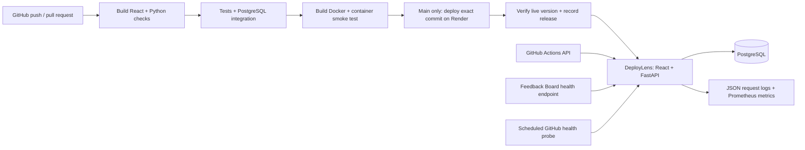

# DeployLens architecture

DeployLens is a public, read-only operations dashboard for Gaurav's internship project.
The operator configures one monitored service and one GitHub repository. Public visitors
cannot change targets, trigger deployments, or submit monitoring results.

The frontend compiles into static assets served by FastAPI in one non-root container.
This keeps deployment simple and avoids cross-origin credentials. PostgreSQL stores
health samples, incidents, pipeline snapshots and verified releases. SQLAlchemy uses
parameterized queries; migrations run explicitly before production startup.

The single-worker collector checks the operator-selected URL every 60 seconds while the
app runs and polls GitHub every five minutes. No arbitrary URL input is exposed.
An incident opens on the first failed probe and closes on recovery. Missing/stale samples
are shown as unknown. Sample success is explicitly not a continuous uptime SLA.

Production uses a separate PostgreSQL schema and restricted database role. The release
callback requires a 32+ character bearer secret and accepts only the running commit SHA.
Tokens, request bodies, query strings and connection details are never logged. Public
logs show only sanitized route, status, timing and request ID. Process counters reset on restart.

CI tests pull requests without deployment credentials. Production deploys require all
checks and use GitHub's production environment. Render rebuilds the validated commit's
Dockerfile; this is source-commit deployment, not promotion of the CI image digest.

## Design contract

Audience: a developer checking a release. Primary action: inspect the latest pipeline.
The first screen prioritizes service health, pipeline stages, release history and incidents.
Use a quiet graphite canvas, warm white surfaces and restrained teal status accents;
system sans-serif plus system monospace, no licensed external assets needed.
Navigation switches between overview, pipelines, incidents and logs. Search filters releases.
Target viewports: 1440x1000, 768x1024, 390x844. Keyboard focus remains visible; no required motion.
Loading keeps page structure; empty history explains the next event; errors offer retry;
partial data keeps saved results and shows GitHub sync status; success includes last refresh.
Permission boundary: dashboard is public read-only, write API requires pipeline authentication.

## Primary references

- https://github.com/render-oss/cli/blob/main/pkg/deploy/repo.go (official commitId deployment API)
- https://render.com/docs/docker (Docker runtime and deployment)
- https://docs.github.com/en/rest/actions/workflow-runs (pipeline history)
- https://docs.github.com/en/actions/security-for-github-actions/security-guides/security-hardening-for-github-actions
- https://vite.dev/guide/ (React build requirements)
- https://fastapi.tiangolo.com/advanced/events/ (collector lifespan)
- https://cheatsheetseries.owasp.org/cheatsheets/Logging_Cheat_Sheet.html
